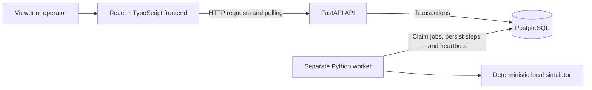

# QTrace architecture

## Components

This is one application with an API process and a worker process sharing one PostgreSQL database. The worker uses the same Python domain and persistence code as the API. PostgreSQL holds the queue as well as application data. There are no external quantum calls or additional messaging services.

The frontend polls lists, details/events, and operational health about every two seconds while visible, avoiding overlapping requests and backing off after errors. It refreshes immediately after mutations, pauses background polling in hidden tabs, and labels stale data. Pagination and filters remain in the URL.

Repository layout: `frontend/`, `backend/` (API, shared persistence, migrations, tests; worker added later), and `docs/`. Use SQLAlchemy and Alembic for persistence and migrations. The foundation stage provides a full local Compose setup for PostgreSQL, a one-shot migration runner, the API, and the frontend, as requested. API and frontend can alternatively run as ordinary local processes against PostgreSQL. The separate Python worker is deferred until execution work. Dependency versions are recorded in backend requirements/constraints and the frontend lockfile.

The current jobs page polls `GET /jobs` five seconds after each response, using an eight-second fetch timeout. It pauses recurring requests in hidden tabs, aborts obsolete requests, and labels retained data when refresh fails. The operational health dashboard remains planned. Browser traffic uses same-origin `/api/` requests, proxied by Vite locally or Nginx in Compose. Database secrets stay in server-side configuration; no CORS middleware is needed for this setup.

## Lifecycle

| Current state | Allowed next states | Cause |
| --- | --- | --- |
| `queued` | `running`, `cancelled` | Worker claim or operator cancellation |
| `running` | `succeeded`, `failed`, `cancel_requested` | Simulation completion/failure or operator request |
| `cancel_requested` | `cancelled` | Worker cancellation acknowledgement |
| `succeeded` | None | Terminal |
| `failed` | None | Terminal |
| `cancelled` | None | Terminal |

Creation starts at `queued`. `cancel_requested` remains active until acknowledged, but cannot resume simulation or publish a result. Infrastructure outages do not masquerade as simulated job failures: the worker resumes after recovery. Unsupported stored simulation versions are surfaced as an operational problem rather than silently executed with a different version.

`running` covers compilation, the fictional provider's queueing stage, and execution. The job's initial `queued` state refers to the application's work queue. Events distinguish these phases; a compilation or provider-queueing failure follows `queued → running → failed` with the corresponding failure stage. No additional lifecycle states are introduced.

### Atomic transitions and events

All transitions go through shared domain functions in short transactions. Lock the job row, validate the transition, update the row, allocate the next per-job event sequence, append its event, and commit together. A PostgreSQL transition trigger also rejects illegal status changes, including every transition out of a terminal state. Protect immutable submission and lineage fields at the database layer. Jobs and events are not deleted or edited through the API.

Events have a unique `(job_id, sequence)` constraint and are ordered by sequence, not timestamp. Event inserts and progress updates lock the same job row as status changes. Keep row locks only for persistence work, never during simulated waiting. Source terminal jobs are not updated when retried; lineage is found by querying the new jobs.

### Cancellation race policy

Queued cancellation and worker claim contend for the same row lock. If cancellation commits first, claim is impossible. If claim commits first, cancellation requests `cancel_requested`.

Completion/failure and cancellation also contend for the row lock. The first valid transaction to commit wins. If completion wins, cancellation returns 409. If cancellation wins, completion must discard its computed result and acknowledge cancellation. Repeating cancellation on `cancel_requested` or `cancelled` returns the current job without adding another event. Other terminal states return 409.

The worker checks for cancellation before each logical step and finalization, and during waits at intervals of at most one second while healthy. This is a checkpoint bound, not a wall-clock guarantee during outages. After recovery, it services pending cancellation before advancing execution.

### Retry policy

Retry accepts only a terminal source. In one transaction, validate permission and source state, resolve the idempotency key, create a new queued job and creation event, and persist the request/result mapping. A unique constraint on `(actor_id, idempotency_key)` serializes duplicate creation requests. Store a fingerprint including operation, source ID, and body so key reuse for a different request returns 409.

Copy the specification, scenario, seed, and simulation version. Set `retry_of` to the source and `original_job_id` to the source's root or the source itself. The source is unchanged. New submissions also require an idempotency key using the same actor-wide namespace. Clients retain keys across uncertain network responses and use a new key only for a new intentional action.

## Worker and deterministic simulation

- Start with one worker process. Poll PostgreSQL for queued jobs in creation order and claim under `FOR UPDATE SKIP LOCKED`.
- Claims include an owner token and expiring lease. Each progress write verifies ownership and an unexpired lease under the job lock. Renewal, cancellation checks, progress, and heartbeat run between bounded simulation waits.
- Persist logical step index and simulator output with each step event. Uncommitted work can be recomputed; committed steps cannot be emitted twice.
- On a worker crash, lease expiry allows the worker after restart to reclaim `running` or `cancel_requested` jobs without resetting state to `queued`. A fresh owner token fences off a stale process. Recovery of `cancel_requested` immediately acknowledges cancellation.
- Use a one-second heartbeat, an initial ten-second stale threshold, and a fifteen-second lease, configured centrally and documented when implemented. Use database time for heartbeat and lease decisions.
- Derive a plan from canonical specification data, scenario, integer seed, and simulation version using a stable digest and defined deterministic algorithm, not Python's process-randomized `hash()` or unrecorded randomness.
- The plan defines logical steps, synthetic waits, result, and any failure step/reason. Replays preserve semantic output; IDs, actual timestamps, recovery events, and operator cancellation may differ.
- Seed examples include a successful job and each supported failure scenario. Provider names must visibly identify them as synthetic.

## Minimal persistence model

| Entity | Main fields and constraints |
| --- | --- |
| `users` | ID, unique demo username, password hash, viewer/operator role |
| `jobs` | UUID, name, provider key, immutable JSON specification, scenario, seed, simulation version, status, creation/start/finish timestamps, result or failure reason, retry/root foreign keys, logical step, next event sequence, lease owner/expiry |
| `job_events` | Job foreign key, sequence, event type, UTC timestamp, actor kind/ID, reason, structured payload; unique job/sequence; append-only |
| `idempotency_records` | Actor/key uniqueness, request fingerprint, resulting job ID; retained with demo data |
| `worker_heartbeats` | Worker ID, database-recorded last heartbeat |

Use explicit allowed statuses and consistency constraints: terminal states have a finish time; successful results and failure details match their states. Index job creation order, status/provider filters, event sequence, retry links, and claim/lease lookup. Job search matches exact UUIDs or case-insensitive exact external references; an index on the lowercased reference supports this lookup. A search service is unnecessary for demonstration data.

### Database stage implementation

Migration `0002_jobs_and_events` implements `jobs` and `job_events`; `0003_external_reference` adds nullable immutable external references and their search index. Users, idempotency records, worker leases, and heartbeat tables remain future work.

- Jobs store UUID, name, provider, target, status, UTC creation/update/start/finish timestamps, `requested_by`, integer row `version`, immutable specification/scenario/seed/`simulation_version`, optional result, error code/message/stage, and nullable `retry_of`/`original_job_id` foreign keys. `requested_by` is an explicit demonstration actor identifier until authentication is implemented.
- Events store UUID, job foreign key, per-job `sequence`, UTC `occurred_at`, stage, `from_status`, `to_status`, message, JSON object details, correlation UUID, and actor identifier. Progress events have `from_status == to_status == running`; creation has a null source and queued destination.
- `version` starts at 1, equals the latest event sequence, and increases for every transition or progress event. It is distinct from `simulation_version`. Row locking allocates the next sequence; an optional expected-version argument rejects stale callers.
- `create_job`, `transition_job`, and `record_progress` in `backend/app/transitions.py` require a caller-owned transaction. A savepoint encloses each operation so a failed event insert also rolls back its job update even if the caller catches the exception. The outer transaction must commit before reporting success.
- PostgreSQL triggers reject invalid status transitions, updates to terminal jobs, mutable submission/lineage fields, job deletion, and event updates/deletion. Checks enforce status/outcome/timestamp consistency. Unique `(job_id, sequence)` supports ordered event reads; composite status/provider/creation indexes support future filters. Correlation and retry/root references are indexed.
- Writes must go through the shared functions to preserve job/event agreement; the database does not independently create events for arbitrary direct SQL writes. No raw-write API is exposed. The shared transition helper rejects every self-transition; a later idempotent cancel endpoint will return an existing cancelled/requested state without calling it.
- The seed command creates 200 deterministic historical jobs with 880 events across three visibly fictional providers. It uses these shared functions, a transaction-scoped advisory lock, fixed IDs/timestamps, and non-destructive skip semantics. There is no execution worker in this stage.

Retries are modeled by nullable references only; no retry action is implemented yet. Later retry operations must validate terminal sources, copy submission values, create the linked job/event atomically, and enforce idempotency as specified above. SQL foreign keys already reject missing references and preserve referenced jobs.

## API boundary

| Endpoint | Role / behavior |
| --- | --- |
| `POST /auth/login` | Demo credentials exchanged for signed expiring token |
| `GET /jobs` | Read-only local demo currently; exact ID/reference search, status/provider/UTC date filters, bounded pagination; roles deferred |
| `POST /jobs` | Operator; validated synthetic submission; `Idempotency-Key` required |
| `GET /jobs/{id}` | Implemented read-only local demo: full job record, ordered events, and history consistency flag; roles deferred |
| `GET /jobs/{id}/events?after_sequence=…` | Planned: separate bounded event batches/cursor for larger histories; not implemented yet |
| `POST /jobs/{id}/cancel` | Operator; atomic cancellation policy |
| `POST /jobs/{id}/retry` | Operator; `Idempotency-Key` required; returns new job |
| `GET /health/live` | Minimal public API liveness |
| `GET /health/ready` | Minimal public database readiness; 503 on failure |
| `GET /health` | Viewer/operator; aggregate counts and worker freshness |

Use 401 for missing/invalid identity, 403 for insufficient role, 404 for unknown jobs, 409 for state or idempotency conflict, and 422 for invalid inputs. Creation returns 201; an idempotent replay returns 200 with the existing job. Cancellation returns 200 with the authoritative state, which may still be `cancel_requested`. Return structured errors suitable for UI feedback without internal stack traces.

Demo authentication uses server-side password verification and signed tokens with validated expiry and role. Keep the signing secret in environment configuration. Restrict local CORS origins explicitly. This design is for local portfolio use; public deployment and production identity design belong to a later reviewed scope.

## Checks to implement

Use pure domain/simulator tests for transition tables and deterministic plans, API tests for validation and roles, and integration tests against PostgreSQL for locks, constraints, rollback, leases, event ordering, and idempotency. SQLite cannot validate the PostgreSQL concurrency behavior. Exercise queued claim/cancel and running completion/cancel races in both commit orders. Add browser checks for search, polling, timeline, actions, and degraded health. Exact commands and actual outcomes will be recorded as implementation stages land.

## Job-list stage

`backend/app/job_list.py` validates query parameters before database access, applies all selected filters with AND, and returns a summary DTO without specifications, results, or event payloads. Provider options are queried from actual jobs rather than duplicated in frontend constants. Counts, rows, and provider options share one repeatable-read snapshot. Newest-first ordering always includes the UUID tie breaker; offset page size is bounded to 100. Unknown providers return no matches; invalid query shapes return 422; database failures return a sanitized 503.

External references are immutable, nullable, and indexed case-insensitively. Migration 0003 backfills only the new field for existing deterministic demo fixtures. Its table-exclusive migration transaction temporarily disables the old row-write guard for that enrichment, re-enables it, and adds a reference guard. State, version, timestamps, and events are preserved; a PostgreSQL migration test checks this explicitly.

The React jobs page retains the existing workspace shell and styling. Applied filters and pagination are encoded in the URL; draft edits apply only on submission. History navigation restores inputs and results. Loading, no matches, out-of-range pages, validation/service errors, retry, and stale-refresh feedback are implemented. Permissions and actions remain deferred; the details stage below adds investigation.

## Details and failure investigation stage

`backend/app/job_details.py` adds `GET /jobs/{UUID}` with a typed job record and all events ordered by sequence in one repeatable-read snapshot. No database migration is needed. A `history_complete` flag checks sequence continuity through the recorded row version, initial state, transition continuity, and agreement between the latest event and job state/update timestamp. No events or failure explanations are synthesized. Missing jobs return 404, malformed IDs return 422, and database exceptions are sanitized as 503.

The frontend routes `/jobs/{UUID}` to `JobDetails.tsx`. Native links keep the applied list query on the details URL, while API requests use only the job UUID. Back links use a fixed local root plus that query, avoiding arbitrary return destinations. Retry/root links preserve the same list context. Polling replaces complete snapshots without duplicating events, pauses while hidden, aborts obsolete requests, and labels stale evidence after failed refreshes.

Failure metadata is copied directly from the job. The failure panel's correlation ID comes from the recorded transition into failed, and each timeline event exposes its own correlation context. Empty diagnostics, absent fields/events, and incomplete histories are explicitly labeled. Structured JSON is rendered as escaped text inside native expandable details; no AI inference or root-cause classification is performed.

The full-history response is suitable for the current small demonstration histories. Separate event pagination remains deferred; long histories will need bounded batches before larger workloads. Authentication, worker execution, and operator actions remain separate stages.

A saved Playwright test filters failed jobs, follows a real job link, verifies failure evidence/timeline against the API, expands diagnostics, reloads, and returns to the filtered list. PostgreSQL tests verify tied event timestamps, job isolation, incomplete audit history, missing jobs, and sanitized failures. React tests cover rendering, missing diagnostics, missing/invalid jobs, retry, and stale polling.
